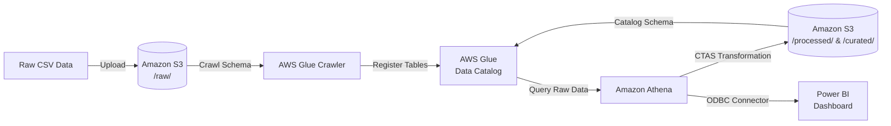

# Cloud-Data-Warehouse-Dashboard-Pipeline (in progress)

## Overview

This project demonstrates the end-to-end implementation of a cloud data pipeline. It showcases the ability to ingest raw data, catalog it, transform it through distinct storage layers, and serve it to a business intelligence tool using AWS S3, AWS Glue, Amazon Athena, and Power BI.

Architecture Diagram (plaintext) 

[ Raw Data (CSV) ] >>>> [ AWS S3: raw/ ] >>>> [ AWS Glue Crawler ] >>>> [ Glue Data Catalog / Athena ] >>>> [ Glue ETL / Athena CTAS ] >>>> [ AWS S3: processed/ ] >>>>
[ AWS S3: curated/ ] >>>> [ Amazon Athena ] >>>> [ Power BI Dashboard ]

Architecture Diagram (interactive)

## Project Structure & Layers

The storage layer is partitioned into three distinct stages inside an Amazon S3 bucket:

  ### raw/ (Landing Layer)

Stores the unedited source datasets (e.g., freight or retail sales data in CSV format).
Serves as the immutable source of truth for the pipeline.

  ### processed/ (Transformation Layer)

Contains cleaned and reshaped data.
Handled null values, corrected data types, and applied initial filtering/aggregations.

  ### curated/ (Serving/Analysis Layer)

  Business-ready, highly optimized summary tables containing the key performance indicators (KPIs) required directly by analytics tools.

## Pipeline Execution Steps
1. Ingestion & Landing

    S3 Setup: Created an S3 bucket configured with a structured folder architecture (raw/, processed/, curated/).

    Data Upload: Uploaded the raw source CSV files into the raw/ directory.

