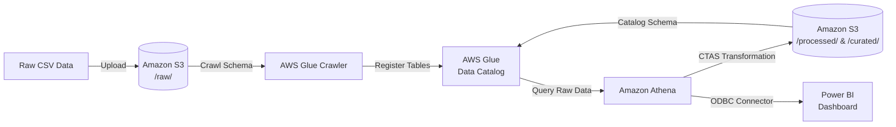

# Cloud-Data-Warehouse-Dashboard-Pipeline 

## Overview

This project demonstrates the end-to-end implementation of a cloud data pipeline. It showcases the ability to ingest raw data, catalog it, transform it through distinct storage layers, and serve it to a business intelligence tool using AWS S3, AWS Glue, Amazon Athena, and Power BI.

## Project Purpose & Key Proof Points
The primary purpose of this project is to prove practical, hands-on capabilities in modern cloud data engineering and data warehousing practices. Specifically, it proves the ability to:

Land & Organize Data: Architect structured multi-tier cloud storage in AWS S3 (`raw/`, `processed/`, `curated/`).\
Catalog Metadata: Use AWS Glue Crawlers and Glue Data Catalog for automated schema inference and centralized metadata management.\
Transform & Optimize: Reshape data and apply columnar storage formats (Apache Parquet + Snappy Compression) via Amazon Athena CTAS to minimize query cost and latency.\
Model for Consumption: Create curated summary layers pre-aggregated for business KPIs, mirroring enterprise data lakehouse standards.\
Serve Analytics: Securely interface cloud engines with Power BI via ODBC connections using granular AWS IAM policies.

### Architecture Diagram (plaintext) 

[ Raw Data (CSV) ] >>>> [ AWS S3: raw/ ] >>>> [ AWS Glue Crawler ] >>>> [ Glue Data Catalog / Athena ] >>>> [ Athena CTAS ] >>>> [ AWS S3: processed/ ] >>>>
[ AWS S3: curated/ ] >>>> [ Amazon Athena ] >>>> [ Power BI Dashboard ]

### Architecture Diagram (interactive)

## Project Structure & Layers

The storage layer is partitioned into three distinct stages inside an Amazon S3 bucket:

  ### raw/ (Landing Layer)

Stores the unedited source datasets (e.g., freight or retail sales data in CSV format).
Serves as the immutable source of truth for the pipeline.

  ### processed/ (Transformation Layer)

Contains cleaned and reshaped data.
Handled null values, corrected data types, and applied initial filtering/aggregations.

  ### curated/ (Serving/Analysis Layer)

  Business-ready, highly optimized summary tables containing the key performance indicators (KPIs) required directly by analytics tools.

## Pipeline Execution Steps

Phase 1: Ingestion & Raw Data Landing (Bronze Layer)
Provisioned an AWS S3 bucket (`aaf-cloud-pipeline-data-bucket`) structured into three distinct zones: `raw/`, `processed/`, and `curated/`.
Uploaded raw trade transactional logs containing transaction dates, country codes, US state information, commodity descriptions (`commodity2`), trade types (`trdtype`), trade values, freight charges, and shipping weights.

Phase 2: Metadata Cataloging & Data Exploration
Deployed an AWS Glue Crawler targeting the `raw/` S3 folder to infer data schemas and populate the `aaf_cloud_pipeline_raw_db` Glue Data Catalog table (`processed_trade_data`).
Executed exploratory SQL queries directly in Amazon Athena to inspect row counts, check for missing values (`NULL` dates), and profile unique categorical fields prior to transformation.

Phase 3: Data Transformation & Standardization (Silver Layer)
Developed transformation queries using Athena `CREATE TABLE AS SELECT` (CTAS) to handle null values, standardize data types, and re-partition fields.
Converted CSV inputs to Parquet format written to `s3://aaf-cloud-pipeline-data-bucket/processed/`, improving scanning performance and reducing storage footprint.

Phase 4: Curated KPI Modeling (Gold Layer)
Built a final curated summary table (`curated_trade_kpis`) under `s3://aaf-cloud-pipeline-data-bucket/curated/` modeled specifically for dashboard consumption.
Pre-aggregated key metrics (`aggregate_trade_value`, `aggregate_freight_charges`, `aggregate_shipping_weight`, `total_shipments`) across analytical dimensions (`trade_year`, `trade_month`, `country`, `usastate`, `commodity2`, `trdtype`).
Validated business logic, uniqueness constraints, and reconciliation balances between raw and gold layers.

Phase 5: BI Serving, Dashboarding & Documentation
Configured IAM security policies (`PowerBIAthenaCuratedPolicy`) for programmatic access using dedicated Access/Secret key pairs.
Installed and configured the 64-bit Amazon Athena ODBC Driver 2.x on Windows (DSN: `Cloud Pipeline_Curated`).
Connected Power BI Desktop to Athena, created DAX calculations, built an executive KPI dashboard, and documented technical steps.

#### NB: Screenshots of process and Dashboard located in docs/screenshots folder 

## Future Enhancements & Next Steps
Pipeline Automation: Automating Glue Crawlers and CTAS queries using AWS Glue Workflow triggers or an AWS Lambda function triggered on new file uploads to the `raw/` bucket.\
Data Orchestration: Integrating Apache Airflow or AWS Step Functions to manage dependency checks, error notifications, and automated pipeline restarts.\
CI/CD Infrastructure as Code: Provisioning S3 buckets, Glue catalogs, and IAM roles using Terraform or AWS CloudFormation templates instead of manual console setup.
